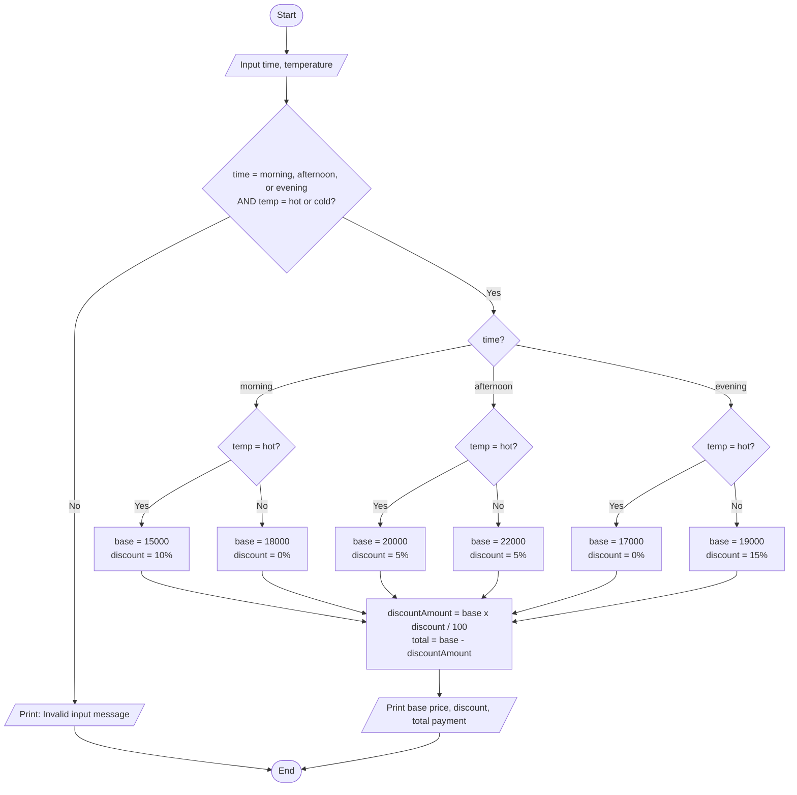

# Mid-Exam - Cafe Cashier Program

- **Name:** Raul Ibrahim Hernov
- **NIM:** 264107020258
- **Class:** TI_1I


## 1. Problem Description

A cafe needs a cashier program that determines the final drink price based on the order time (morning, afternoon, evening) and the drink temperature (hot, cold).

Base prices:

| Time      | Temperature | Base Price (IDR) |
|-----------|-------------|------------------|
| morning   | hot         | 15,000           |
| morning   | cold        | 18,000           |
| afternoon | hot         | 20,000           |
| afternoon | cold        | 22,000           |
| evening   | hot         | 17,000           |
| evening   | cold        | 19,000           |

Discount rules:

| Time      | Discount                |
|-----------|-------------------------|
| morning   | 10% for hot drinks      |
| afternoon | 5% for all drinks       |
| evening   | 15% for cold drinks     |

If the input is invalid, the program prints: `Invalid input. Please make sure time = (morning/afternoon/evening) and temperature = (hot/cold).`

## 2. Flowchart



## 3. Source Code

File: `CafeCashier.java`

```java
import java.util.Scanner;

public class CafeCashier {
    public static void main(String[] args) {
        Scanner input = new Scanner(System.in);

        System.out.print("Enter time (morning/afternoon/evening): ");
        String time = input.nextLine().trim().toLowerCase();
        System.out.print("Enter drink temperature (hot/cold): ");
        String temp = input.nextLine().trim().toLowerCase();

        boolean validTime = time.equals("morning") || time.equals("afternoon") || time.equals("evening");
        boolean validTemp = temp.equals("hot") || temp.equals("cold");

        if (!validTime || !validTemp) {
            System.out.println("Invalid input. Please make sure time = (morning/afternoon/evening) and temperature = (hot/cold).");
        } else {
            int basePrice = 0;
            int discountPercent = 0;

            if (time.equals("morning")) {
                if (temp.equals("hot")) {
                    basePrice = 15000;
                    discountPercent = 10;
                } else {
                    basePrice = 18000;
                }
            } else if (time.equals("afternoon")) {
                if (temp.equals("hot")) {
                    basePrice = 20000;
                } else {
                    basePrice = 22000;
                }
                discountPercent = 5;
            } else { // evening
                if (temp.equals("hot")) {
                    basePrice = 17000;
                } else {
                    basePrice = 19000;
                    discountPercent = 15;
                }
            }

            int discountAmount = basePrice * discountPercent / 100;
            int total = basePrice - discountAmount;

            System.out.println("Base price: " + basePrice);
            System.out.println("Discount: " + discountPercent + "% (" + discountAmount + ")");
            System.out.println("Total payment: " + total);
        }

        input.close();
    }
}
```

## 4. Explanation

1. The program reads the time and temperature, then trims spaces and converts them to lowercase so the input is not case sensitive.
2. Two boolean variables (`validTime`, `validTemp`) check whether the input is one of the allowed values. If either is false, the invalid input message is printed and the program ends.
3. If the input is valid, nested if statements select the base price and the discount percent for the time and temperature combination.
4. The discount amount is `basePrice * discountPercent / 100`, and the total payment is `basePrice - discountAmount`.
5. The base price, discount, and total payment are printed in the format required by the sample execution.

## 5. Test Results

| Time      | Temperature | Base Price | Discount     | Total Payment |
|-----------|-------------|------------|--------------|---------------|
| morning   | hot         | 15000      | 10% (1500)   | 13500         |
| morning   | cold        | 18000      | 0% (0)       | 18000         |
| afternoon | hot         | 20000      | 5% (1000)    | 19000         |
| afternoon | cold        | 22000      | 5% (1100)    | 20900         |
| evening   | hot         | 17000      | 0% (0)       | 17000         |
| evening   | cold        | 19000      | 15% (2850)   | 16150         |

Sample run (valid input):

```
Enter time (morning/afternoon/evening): morning
Enter drink temperature (hot/cold): hot
Base price: 15000
Discount: 10% (1500)
Total payment: 13500
```

Sample run (invalid input):

```
Enter time (morning/afternoon/evening): night
Enter drink temperature (hot/cold): warm
Invalid input. Please make sure time = (morning/afternoon/evening) and temperature = (hot/cold).
```
